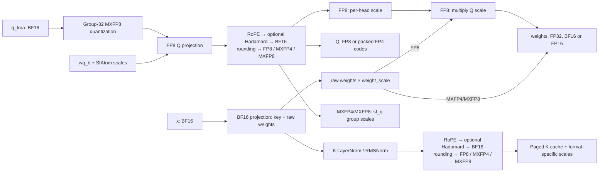

# indexer_prepare

`halops.indexer_prepare` fuses the DSA indexer's Q/K preparation into one persistent CUDA kernel.

The supported specialization uses hidden size 4096, Q LoRA rank 1024, 64 heads, head dimension 128, and rotary dimension 64. It requires an SM100-family GPU with at least 128 available SMs. The fixed dimensions are checked at the API boundary.

## Computation and outputs



Both Q and K default to **NeoX RoPE** on their first 64 elements: dimension `i` pairs with `i + 32` for `i < 32`. Set `is_neox_style=False` to use adjacent pairs `(2*i, 2*i+1)`. Both layouts use the same rotary table `[cos(32) | sin(32)]`, and dimensions 64–127 are unchanged by RoPE. The flag is passed to every kernel path, including the single-token and small-batch specializations. Supplying a K normalization bias selects LayerNorm; `None` selects RMSNorm. Hadamard rotation is the normalized 128-point transform.

All modes return **`((q, sf_q), weights)`** and accept the optional output buffers
`out_q=None, out_q_sf=None, out_weights=None`. Missing buffers are allocated independently;
supplied buffers are written in place and returned as the same Python objects.

`weights` can be FP32, BF16 or FP16. `out_weights_dtype` (`None`,
`torch.float32`, `torch.bfloat16` or `torch.float16`) selects the dtype of an
allocated weights; `None` allocates FP32. A supplied `out_weights` buffer selects
the output dtype itself; if `out_weights_dtype` is also given, it must equal
`out_weights.dtype`. Weights are computed in FP32 and rounded to nearest even when
stored, so BF16/FP16 weights equal the FP32 weights converted with `.to()`.

With `out_qk_dtype_str=None` (default) or `"fp8"`, `q` is FP8 and `sf_q` is `None`.
`weights` already includes the per-head Q scale. A downstream index score can therefore use:

```text
score[t, k] = sum_h weights[t, h] *
             relu(dot(q[t, h].float(), K_fp8[k].float() * K_scale[k]))
```

Do not multiply FP8 Q by a separate scale again.

With `out_qk_dtype_str="mxfp4"`, the same return structure contains:

- `q`: contiguous uint8 `[T, 64, 64]`, two E2M1 values per byte. Even elements occupy the low nibble; odd elements occupy the high nibble.
- `sf_q`: contiguous uint8 `[T, 64, 4]`, linear UE8M0 scale bytes, one per group of 32 elements. Decode a scale byte `e` as `2**(e - 127)`.
- `weights`: FP32 `[T, 64]` by default, equal to `raw_weights * weight_scale`. Q group scales are stored separately and are **not** folded into this scalar weight.

The FP4 downstream contract is:

```text
Q[t,h,d] = decode_e2m1(q[t,h,d//2], d%2) * 2**(sf_q[t,h,d//32] - 127)
K[k,d]   = decode_e2m1(K_fp4[k,d//2], d%2) * 2**(K_scale[k,d//32] - 127)
score[t,k] = sum_h weights[t,h] * relu(dot(Q[t,h], K[k]))
```

FP4 quantization rounds the post-RoPE/Hadamard values to BF16, then uses
`2**ceil(log2(max(amax, 1e-10)/6))` per 32-element group (UE8M0 exponent clamped to 0–254).
The scale exponent is computed from the BF16 maximum's IEEE exponent and
mantissa, avoiding division and fast-math `log2` errors at power-of-two boundaries. E2M1 midpoint ties select
the larger magnitude, matching the E2M1 rounding convention of HALOps
`group_wise_quant(..., mode="w4a4-mxfp4", use_swizzle=False)`.
The CUDA implementation uses native `cvt.rn.satfinite.e2m1x2.f32` conversion.
A one-FP32-ulp upward bias of the inverse scale preserves this midpoint
convention; signed zeros are canonicalized before packing. Paired FP32
multiplication and BF16 rounding reduce the conversion instruction count.
Projection weights and internal Q-LoRA quantization remain group-32 MXFP8.
`out_qk_dtype_str` selects Q and K output encodings together; it does not convert an
existing cache. Allocate the matching page layout before the call.

With `out_qk_dtype_str="mxfp8"`, Q is contiguous E4M3 `[T, 64, 128]` and
`sf_q` is contiguous uint8 UE8M0 `[T, 64, 4]`. K uses the same group-32
quantization. After BF16 rounding, each group uses
`2**ceil(log2(max(amax, 1e-10)/448))`, with encoded exponents clamped to 0–254.
FP8 conversion uses round-to-nearest-even. Decode Q/K by multiplying each
32-element group by its own scale; `weights = raw_weights * weight_scale`.
All Q epilogues and the K cache writer quantize directly inside the fused kernel.
The kernel does not launch a separate output quantization pass.

The default `weight_scale=None` selects `head_dim**-0.5 * n_heads**-0.5`
(`128**-0.5 * 64**-0.5` for this build). An explicit `weight_scale=0.0`
produces zero weights. `skip_q=True` only prepares K and leaves preallocated
Q, Q scales and weights untouched; newly allocated outputs are undefined in that mode.

## Inputs

All tensors must be on the same CUDA device. Except for the activation row
strides, inputs and outputs must be contiguous.

| Argument | Shape / dtype | Contract |
| --- | --- | --- |
| `x` | `[T, 4096]`, BF16 | Positive T; unit column stride; 16-byte aligned base and row stride |
| `q_lora` | `[T, 1024]`, BF16 | Unit column stride; 8-byte aligned base and row stride |
| `wk_w` | `[192, 4096]`, BF16 | First 128 rows project K; remaining 64 project raw weights |
| `wq_b` | `[8192, 1024]`, E4M3 FP8 | Q projection weight |
| `wq_b_sf` | `[8192, 32]`, uint8 | Group-32 UE8M0 scales in CUTLASS SfAtom layout, as returned by `group_wise_quant(..., use_swizzle=True)` |
| `k_norm_weight`, `k_norm_bias` | `[128]`, FP32 | 16-byte aligned; bias may be `None`; epsilon must be finite and positive |
| `rope_cos_sin_cache` | `[max_position, 64]`, FP32 | 8-byte aligned |
| `positions` | `[T]`, int32 / int64 | In-range rotary positions; values must fit int32 |
| `paged_kv_cache_with_scale` | `[pages, page_size * 132]` (FP8/MXFP8) or `[pages, page_size * 68]` (FP4), uint8 | 4-byte aligned; page_size must be a positive power of two |
| `out_cache_loc` | `[T]`, int32 / int64 | Negative values skip K writes; other values must be unique, in range, and fit int32 |
| `out_q` (optional) | `[T, 64, 128]`, E4M3 FP8; or `[T, 64, 64]`, uint8 for MXFP4 | 16-byte aligned output |
| `out_q_sf` (optional, MXFP4/MXFP8) | `[T, 64, 4]`, uint8 | Linear group-32 UE8M0 scales; must be `None` for FP8 |
| `out_weights` (optional) | `[T, 64]`, FP32 / BF16 / FP16 | 16-byte aligned output; its dtype selects the stored dtype |
| `out_weights_dtype` | `None` (default), `torch.float32`, `torch.bfloat16` or `torch.float16` | Dtype of allocated weights; `None` allocates FP32. Must equal `out_weights.dtype` when both are given |
| `out_qk_dtype_str` | `None` (default), `"fp8"`, `"mxfp8"` or `"mxfp4"` | Selects the Q and K-cache encoding; `None` selects FP8 |
| `use_pdl` | bool, default `True` | Enable Programmatic Dependent Launch; `False` uses an ordinary stream launch |

Each K cache page stores **all data rows followed by all scale rows**, with no swizzle:

```text
FP8 page (page_size * 132 bytes)
  [page_size × 128 FP8 bytes]
  [page_size × 4 FP32 scale bytes]

MXFP8 page (page_size * 132 bytes)
  [page_size × 128 E4M3 bytes]
  [page_size × 4 UE8M0 scale bytes]

MXFP4 page (page_size * 68 bytes)
  [page_size × 64 packed E2M1 bytes]
  [page_size × 4 UE8M0 scale bytes]
```

`out_cache_loc` indexes slots across the page pool, independently of rotary positions. The host validates shapes, dtypes, devices, contiguity and alignment. Index values and overlapping cache slots are caller preconditions; the wrapper does not copy device index tensors to the CPU.

`wq_b_sf` is passed directly to the kernel. Use
`halops.group_wise_quant(..., mode="w8a8-mxfp8", use_swizzle=True)` to produce
the accepted uint8 group-32 SfAtom layout.

## Programmatic Dependent Launch

`use_pdl=True` enables the CUDA programmatic stream serialization launch
attribute. The kernel can initialize its private barriers and acquire TMEM
before its predecessor finishes, then waits for the predecessor before
reading tensor data. After that wait and its private initialization, it signals
that a PDL successor may start initializing. The successor's dependency wait
still waits for this whole grid to complete, including output writes and the
last counter reset, before reading those outputs. Consecutive calls can
therefore reuse internal scratch on the same stream.

The option is supported by eager execution, CUDA Graph capture/replay, all
output formats, and `skip_q`. It does not establish synchronization between
independent streams: callers still serialize accesses to shared outputs.
The native binding also defaults to `use_pdl=True`. Remove the former workspace
argument from both Python and native calls when adopting this interface.

For 5–16 tokens, the default launch assigns 32 CTAs to the K/weights
projection and 64 CTAs to the Q projection. Q LoRA quantization runs once in
the vector warps of the K/weights CTAs and is published for the Q TMA
loaders. This is CTA work assignment, not binding to physical SM numbers.

## Example

```python
import torch
from halops import group_wise_quant, indexer_prepare

device = "cuda"
T, page_size = 64, 64
x = torch.randn(T, 4096, dtype=torch.bfloat16, device=device)
q_lora = torch.randn(T, 1024, dtype=torch.bfloat16, device=device)
wk_w = torch.randn(192, 4096, dtype=torch.bfloat16, device=device)
wq_b, wq_b_sf = group_wise_quant(
    torch.randn(8192, 1024, dtype=torch.bfloat16, device=device),
    mode="w8a8-mxfp8",
    use_swizzle=True,
)
gain = torch.ones(128, device=device)
bias = torch.zeros(128, device=device)
rope = torch.cat(
    [torch.ones(T, 32, device=device), torch.zeros(T, 32, device=device)], dim=-1
)
positions = torch.arange(T, dtype=torch.int64, device=device)
cache = torch.empty((1, page_size * 132), dtype=torch.uint8, device=device)
(q, sf_q), weights = indexer_prepare(
    x, q_lora, wk_w, wq_b, wq_b_sf,
    gain, bias, 1e-6, rope, positions, cache, positions,
)
assert q.shape == (T, 64, 128)
assert sf_q is None
assert weights.shape == (T, 64)
```

To select MXFP4, allocate a matching cache and optionally preallocate all outputs:

```python
cache_fp4 = torch.empty((1, page_size * 68), dtype=torch.uint8, device=device)
q_packed = torch.empty((T, 64, 64), dtype=torch.uint8, device=device)
q_scales = torch.empty((T, 64, 4), dtype=torch.uint8, device=device)
weights_out = torch.empty((T, 64), dtype=torch.float32, device=device)
(q, sf_q), weights = indexer_prepare(
    x, q_lora, wk_w, wq_b, wq_b_sf,
    gain, bias, 1e-6, rope, positions, cache_fp4, positions,
    out_qk_dtype_str="mxfp4", out_q=q_packed, out_q_sf=q_scales, out_weights=weights_out,
    is_neox_style=True,  # default; False retains adjacent-pair RoPE
)
assert q is q_packed
assert sf_q is q_scales
assert weights is weights_out
```

The optional arguments after `out_cache_loc` are ordered as
`weight_scale, n_heads, head_dim, is_neox_style, apply_hadamard, skip_q,
use_pdl, out_qk_dtype_str, out_weights_dtype, out_q, out_q_sf, out_weights`.
The wrapper normalizes `out_qk_dtype_str=None` to `"fp8"` before deriving the
format flags. FP8 callers supply `out_q_sf=None` when preallocating outputs.
Callers must migrate `output_dtype_str` to `out_qk_dtype_str`,
`output_weights_dtype` to `out_weights_dtype`, and the output arguments
`q, sf_q, weights` to `out_q, out_q_sf, out_weights`.
`"fp4"` is not an accepted format string; use `"mxfp4"`.
All three formats use the same nested return structure shown above.

## Internal buffers and CUDA Graphs

Call `indexer_prepare` directly. It allocates and initializes its scratch internally;
there is no workspace argument or separate workspace helper.

The selected schedule determines the allocation for the **current** token count and
output format. Split-K partials and raw weights use only valid token rows. Quantized
query activations also use the current token count, with TMA bounds supplying zeros
outside valid rows. Only the SfAtom scale buffer retains its required 128-row tiles.
The control prefix contains one grid counter and four counter banks for the current
token groups, with 128-byte slots. No capacity is reserved for smaller batches,
another output format or the largest batch seen previously.

Small local-Q paths use shared memory and omit unused query scratch and raw weights.
`skip_q` omits query activation/scale buffers.

Each host thread caches one scratch tensor per device/stream. Calls reuse it
when the capture ID, total bytes and control-prefix bytes match. A miss allocates
the exact current size with `torch::empty` and initializes only the control prefix
with a single-CTA clear kernel, using the actual control-prefix byte count. With
`use_pdl=True`, the clear participates in PDL: it waits for its predecessor,
triggers the indexer's independent initialization, then clears the prefix.
The indexer's dependency wait completes before it accesses any counters.
With `use_pdl=False`, both kernels use ordinary same-stream launches.
A size decrease replaces the larger tensor. The compute kernel
overwrites data scratch and resets its active counters before completing.

Layers on the same host thread and stream can reuse scratch across intervening
operators, provided their workspace requirements match. Distinct streams and
host threads have separate entries; no global container or mutex is needed.
Switching host threads loses reuse but does not share mutable scratch. Entries
live until replacement or host-thread exit. Long-lived threads using many streams
retain one tensor per stream; this is separate from PyTorch allocator reservations.

Each capture allocates from its graph pool rather than reusing eager or another
capture's scratch. For N matching layer calls on one stream, the graph contains
one control-prefix clear and N compute kernels. The first clear runs on every
replay; subsequent layers rely on counter reset. Replay does not execute the
host cache lookup. The graph pool retains captured storage even after the host
cache entry is replaced or its owning thread exits.

Replays sharing graph-pool memory or outputs must obey the caller's pool lifetime
and replay-order rules, including serialization of the same graph. Independent
concurrent graphs need independent storage.
The persistent-grid kernels also require the documented resident-grid execution
environment. A host mutex would not establish CUDA stream dependencies.

Preallocate `out_q`, `out_q_sf` and `out_weights` when the caller needs stable output addresses:

```python
# Warm up before capture, then capture the same direct operator call.
indexer_prepare(**inputs, out_q=q_out, out_q_sf=sf_q_out, out_weights=weights_out)
graph = torch.cuda.CUDAGraph()
with torch.cuda.graph(graph):
    result = indexer_prepare(**inputs, out_q=q_out, out_q_sf=sf_q_out, out_weights=weights_out)
graph.replay()
```

The native `halops_kernel.indexer_prepare` takes the first twelve public input
arguments (a CUDA empty FP32 tensor for absent bias), then the required
`out_q, out_q_sf, out_weights, weight_scale`, followed by
`n_heads=64, head_dim=128, is_neox_style=True, apply_hadamard=True,
skip_q=False, use_pdl=True, is_mx_sf=False, is_fp4=False`.
It validates the output and cache layout, writes the supplied buffers and returns
`None`. The Python wrapper allocates missing outputs and packages the nested
result. The native function requires the actual weight scale; it does not expand
the Python default of `None`. Weights are stored in the supplied tensor's dtype.

Both native dispatch and CUDA traits use only these two format flags:

| Q/K format | `is_mx_sf` | `is_fp4` | Q scale output |
| --- | --- | --- | --- |
| FP8 | `False` | `False` | `None`; per-row Q scale folded into weights |
| MXFP8 | `True` | `False` | uint8 UE8M0 `[T, 64, 4]` |
| MXFP4 | `True` | `True` | uint8 UE8M0 `[T, 64, 4]` |

`is_mx_sf` selects group-32 scaling and separate Q scales; `is_fp4` selects
packed E2M1 instead of E4M3 data. `is_fp4=True, is_mx_sf=False` is rejected.
The kernel specialization and quantization helpers use the same two flags.

`indexer_config.cuh` owns shapes, warp roles, pipeline limits, register budgets
and configuration selection. The schedule is selected from the current token
count, output format, output alignment and device SM count.
`indexer_dispatch.cuh` maps that configuration to template specializations and
launches the selected kernel.

## Batch-specific execution

The default dispatch uses one CUDA launch. Output format and RoPE style are
compile-time specializations, while the public interface still selects them at
runtime. Grid sizes are capped by the device SM count.

| Token count | Token tile | Threads | Grid | Q consumers |
| --- | ---: | ---: | ---: | --- |
| 1 | 16 | 256 | 64 | 4 warps per Q head |
| 2–4 | 16 | 384 | 80 | 64 Q CTAs; local activation quantization |
| 5–16 | 16 | 384 | 96 | 16 K + 16 weights + 64 Q CTAs; shared input quantization |
| 17–32 | 32 | 384 | 96 | 4 lanes per token/head |
| 33–128 | 128 | 384 | 96; MXFP4/MXFP8 97–128 uses 112 | 32 KW CTAs (48 for MXFP4/MXFP8 97–128) and 64 Q CTAs; 8 Q drain warps |
| 129–256 | 128 | 384 | 128; FP8 240–256 uses 144 | Shared KW/Q scheduling; 4 Q drain warps |
| 257–1024 | 128 | 384 | 144; FP8 385–400 uses SM count | Shared KW/Q scheduling; 4 Q drain warps |
| Above 1024 | 128 | 384 | SM count | Shared KW/Q scheduling; 4 Q drain warps |

For one token, each CTA owns one Q head and computes two K rows plus one
raw weight with BF16 inputs and FP32 accumulation. Warp 0 of CTA 0 completes
K normalization and cache storage. For 2–4 tokens, 16 CTAs use Tensor Cores
for K, while the Q CTAs quantize activations into shared memory and compute
raw weights locally.
MXFP8 writes each weight when that local projection completes, so its Q
epilogue does not wait for or read a shared raw-weight value.

For 5–16 tokens, K and weights use separate readiness counters, while each
Q CTA's four otherwise idle vector warps reduce its FP8 weight partials
concurrently with Q MMA. MXFP4/MXFP8 weights are finalized in the weights CTAs.
The contiguous `wk_w` tensor is accessed as disjoint row ranges; callers do
not split or repack it. Q postprocessing uses 16 lanes per token/head for
5–8 tokens and 8 lanes for 9–16 tokens.

Each readiness counter first counts producer arrivals, then consumer
acknowledgements. Its last consumer resets it after the final dependent
read. This removes the grid-wide completion counter from the small path;
it does not permit unordered calls sharing internal scratch. Inactive consumers
return before waiting so they cannot observe a counter after its reset.

For 17–32 tokens, Tensor Cores compute both K and weight projections. FP8
Q CTAs reduce the partials for their own head with a warp or subgroup. MXFP4/MXFP8
K workers read contiguous weight partials and write final weights independently. Narrow Q tiles are transposed in shared memory before
RoPE, Hadamard, and quantization. MXFP4/MXFP8 weights are finalized by the K/weight
workers because they do not depend on Q scales.

For 33–128 tokens, the Q CTAs reuse the four activation-quantization warps as
additional Q consumers. The eight warps read TMEM with a two-lane-per-token
layout, perform the postprocessing, and combine adjacent output values into
vector stores. KW CTAs reuse all twelve warps for the K/vector epilogue after
their matrix work finishes. MXFP4/MXFP8 97–128 reserves 48 KW CTAs while retaining
64 Q CTAs. Larger batches use the shared scheduler and
one complete Q head per drain thread. FP8/MXFP8 129–144 and FP8 257–272 use
two passes with two lanes per token/head. MXFP4/MXFP8 partial batches between
257 and 511 use that path when the tail contains at most 48 tokens. These
specializations keep 64 values per lane and omit the second pass when the
tail fits in 16 rows.

Wide FP8 Q consumers start postprocessing as soon as MMA completes, then
acquire the raw-weight publication immediately before the final weight store.
This overlaps the independent Q arithmetic with weight reduction.
Raw weights are also staged into two shared buffers. Up to 256 tokens and
for complete 128-token groups, the RoPE producer performs this prefetch.
Larger partial batches use the projection-weight TMA producer after its TMA
work completes. Work lists longer than two Q items use the independent RoPE
producer to avoid a dependency cycle with accumulator reuse.

The two TMA stages overlap weight/activation loads with MMA. Normalization
gain and bias are copied asynchronously to shared memory before their
consumer reaches the epilogue. Wide Q paths also stage the RoPE table in a
separate producer warp, except MXFP4 with 129–256 tokens and MXFP8 with
145–256 tokens. Consecutive work
items reuse readiness and RoPE data within the invocation. Partial batches
above 256 use two RoPE buffers so the next table can be copied while the
current Q item is processed. Other paths retain one buffer. Nothing caches
mutable tensor contents across calls. RoPE prefetch uses 16-byte copies when
the table permits them and 8-byte copies for the documented minimum alignment.

KW uses split-K16 through 128 tokens and split-K8 for 129–256. Partial batches
between 257 and 511 also use split-K8 to shorten the projection dependency.
Other batches through 1024 use split-K4.
FP8 240–256 uses split-K4 with the larger grid shown above.
Scratch follows the selected schedule and output format for each call.

Activation TMA descriptors bound the input to the valid token count,
avoiding reads of padded activation rows. The scale layout keeps its separate
padded extent.

The wide one-pass epilogue combines Q stores into native 32-byte operations
when the output permits that alignment; valid 16-byte-aligned outputs use
two 16-byte stores. MXFP4/MXFP8's four scale bytes are combined into one 32-bit
store when aligned, with individual-byte stores for the supported minimum
alignment. Native `cvt.rn.satfinite.e2m1x2.f32` conversion preserves the
reference's BF16 midpoint and signed-zero conventions.

Work-list rotation gives longer Q lists to CTAs without KW work. When the
last token group is short, Q items are ordered by token group to balance the
full and partial tiles. Outside the 5–16 specialization, the last completing CTA resets workspace counters
with one warp. Calls that
reuse internal scratch still require stream ordering, including with PDL. These
choices retain the group-32 weight layout and do not add a persistent weight
cache. `skip_q=True` uses the key-only path.

## Source integration and validation

- `halops/indexer/indexer_prepare.py` provides the exported kernel wrapper.
- `csrc/kernel/indexer/indexer_config.cuh` is the configuration entry:
  `IndexerDimensions` / `IndexerTraitsFor` define shapes and pipeline limits;
  `select_indexer_launch_config`, `select_grid_blocks`,
  `select_key_weight_splits`, `configure_indexer_schedule` and
  `select_indexer_kernel` select execution settings.
- `indexer_prepare.cu` constructs the validated host parameters, sets the CUDA
  device guard and calls `dispatch_indexer`.
- `indexer_dispatch.cuh` owns format/RoPE specialization, template argument
  forwarding, kernel selection and CUDA launch.
- `indexer_params.cuh` defines both `IndexerHostParams` and
  `IndexerDeviceParams`. The host constructor checks tensor devices, dtypes,
  shapes, strides, alignment and scalar arguments; `out_q_sf` stays optional.
  `make_indexer_device_params` extracts kernel metadata and pointers, configures
  the schedule, acquires workspace and creates TMA descriptors without repeating
  tensor validation. Workspace/shared-memory layouts and barrier accessors also
  live in this file.
- `indexer_prepare_kernel.cuh` and `indexer_small_kernel.cuh` assign work to warps.
  `indexer_mainloop.cuh` implements projection loads and matrix products;
  `indexer_epilogue.cuh` contains K/weights postprocessing and all Q drain paths.
- `indexer_math.cuh` provides RoPE, Hadamard and quantization math.
  `indexer_gemm.cuh` implements BF16/MXFP8 GEMM pipeline operations.
  `indexer_utils.cuh` groups PTX wrappers, CuTe MMA traits, barriers, operand
  layouts and TMA descriptors. It depends on `indexer_config.cuh`; configuration
  does not depend on these implementation helpers.
- Operator helpers use `halops::indexer` directly. PTX wrappers retain the
  `intrinsics` namespace, and CuTe trait specializations remain in `cute`.
- The MXFP8 projection pipeline defines its MMA, TMA and TMEM layouts locally
  from CuTe/CUTLASS primitives. `IndexerGemmConfig` contains the indexer tile and
  pipeline constants; `GemmInstance` contains only the operand layouts and
  descriptor builders it needs. No indexer header includes another operator's
  private headers. CUDA device/stream helpers come from `common/cuda_utils.h`,
  and PDL launch setup stays in `indexer_dispatch.cuh`.
- `csrc/common/cpp_extensions.cc` and `setup.py` register and build the operator.
- Runtime use has no dependency on DeepGEMM.

Internal names spell out projection, token-group, split and workspace roles:
for example, `key_weight_splits`, `query_tiles_per_split`,
`query_block_offset` and `counter_bank_stride`. Q/K, GEMM, TMA, TMEM and
M/N/K retain their standard attention/CUDA meanings.

Run `python -m pytest tests/test_indexer_prepare.py -q` from the repository
root. These are functional tests without latency measurement. The independent
reference uses the group-32 MXFP8 input floor `1e-10`; the FP8 output row floor
remains `1e-4`. Tests check Q/K codes and scales, folded weights, downstream
scores and untouched cache bytes. They cover exact allocation sizes and shrinkage,
cross-layer reuse, changing layer weights, mixed formats, stream/thread isolation,
graph replay after cache replacement or capturing-thread exit, device
guards, optional outputs and rejected layouts.

## MXFP8 benchmark

`tests/benchmark.py --output-dtype mxfp8` runs the fused operator only.
`--output-dtype mxfp4_mxfp8` compares its two group-32 output formats for
batch sizes 1–512. The formats run adjacent to each other for each batch,
with their order alternating. Dual-stream implementations are excluded from
this comparison because they do not support MXFP8 output.

The default timing uses cold L2 and 16 calls per CUDA Graph. `latency.csv`
records individual format times and the paired MXFP8/MXFP4 ratio when the
second format completes. `metadata.json` reports the geometric mean ratio,
maximum ratio, and whether every measured batch is no slower.

Copyright (c) 2026 PaddlePaddle Authors. All Rights Reserved. Licensed under the Apache License, Version 2.0.
