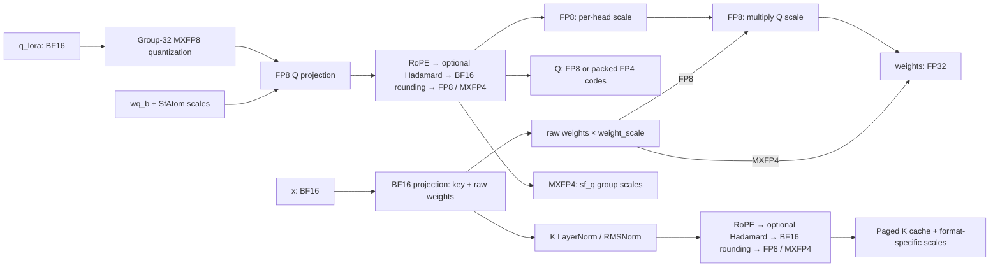

# indexer_prepare

`halops.indexer_prepare` fuses the DSA indexer's Q/K preparation into one persistent CUDA kernel. It is adapted from InferRock branch `mega_indexer_0902`, commit `8d45d147519d2fa09bc47576feeae0a33f805056`.

The supported specialization uses hidden size 4096, Q LoRA rank 1024, 64 heads, head dimension 128, and rotary dimension 64. It requires an SM100-family GPU with at least 128 available SMs. The fixed dimensions are checked at the API boundary.

## Computation and outputs



Both Q and K default to **NeoX RoPE** on their first 64 elements: dimension `i` pairs with `i + 32` for `i < 32`. Set `is_neox_style=False` to use adjacent pairs `(2*i, 2*i+1)`. Both layouts use the same rotary table `[cos(32) | sin(32)]`, and dimensions 64–127 are unchanged by RoPE. The flag is passed to every kernel path, including the single-token and small-batch specializations. Supplying a K normalization bias selects LayerNorm; `None` selects RMSNorm. Hadamard rotation is the normalized 128-point transform.

Both modes return **`((q, sf_q), weights)`** and accept the optional output buffers
`q=None, sf_q=None, weights=None`. Missing buffers are allocated independently;
supplied buffers are written in place and returned as the same Python objects.

With `output_dtype_str="fp8"` (default), `q` is FP8 and `sf_q` is `None`.
`weights` already includes the per-head Q scale. A downstream index score can therefore use:

```text
score[t, k] = sum_h weights[t, h] *
             relu(dot(q[t, h].float(), K_fp8[k].float() * K_scale[k]))
```

Do not multiply FP8 Q by a separate scale again.

With `output_dtype_str="mxfp4"`, the same return structure contains:

- `q`: contiguous uint8 `[T, 64, 64]`, two E2M1 values per byte. Even elements occupy the low nibble; odd elements occupy the high nibble.
- `sf_q`: contiguous uint8 `[T, 64, 4]`, linear UE8M0 scale bytes, one per group of 32 elements. Decode a scale byte `e` as `2**(e - 127)`.
- `weights`: FP32 `[T, 64]`, equal to `raw_weights * weight_scale`. Q group scales are stored separately and are **not** folded into this scalar weight.

The FP4 downstream contract is:

```text
Q[t,h,d] = decode_e2m1(q[t,h,d//2], d%2) * 2**(sf_q[t,h,d//32] - 127)
K[k,d]   = decode_e2m1(K_fp4[k,d//2], d%2) * 2**(K_scale[k,d//32] - 127)
score[t,k] = sum_h weights[t,h] * relu(dot(Q[t,h], K[k]))
```

FP4 quantization rounds the post-RoPE/Hadamard values to BF16, then uses
`2**ceil(log2(max(amax, 1e-10)/6))` per 32-element group (UE8M0 exponent clamped to 0–254).
The scale exponent is computed from the BF16 maximum's IEEE exponent and
mantissa, avoiding division and fast-math `log2` errors at power-of-two boundaries. E2M1 midpoint ties select
the larger magnitude, matching the E2M1 rounding convention of HALOps
`group_wise_quant(..., mode="w4a4-mxfp4", use_swizzle=False)`.
The CUDA implementation uses native `cvt.rn.satfinite.e2m1x2.f32` conversion.
A one-FP32-ulp upward bias of the inverse scale preserves this midpoint
convention; signed zeros are canonicalized before packing. Paired FP32
multiplication and BF16 rounding reduce the conversion instruction count.
Projection weights and internal Q-LoRA quantization remain group-32 MXFP8.
`output_dtype_str` selects Q and K output encodings together; it does not convert an
existing cache. Allocate the matching page layout before the call.

The default `weight_scale=0` selects `128**-0.5 * 64**-0.5`. `skip_q=True` only prepares K and leaves preallocated Q, Q scales and weights untouched; newly allocated outputs are undefined in that mode.

## Inputs

All tensors must be on the same CUDA device. Except for the activation row
strides, inputs and outputs must be contiguous.

| Argument | Shape / dtype | Contract |
| --- | --- | --- |
| `x` | `[T, 4096]`, BF16 | Positive T; unit column stride; 16-byte aligned base and row stride |
| `q_lora` | `[T, 1024]`, BF16 | Unit column stride; 8-byte aligned base and row stride |
| `wk_w` | `[192, 4096]`, BF16 | First 128 rows project K; remaining 64 project raw weights |
| `wq_b` | `[8192, 1024]`, E4M3 FP8 | Q projection weight |
| `wq_b_sf` | `[8192, 32]`, uint8 | Group-32 UE8M0 scales in CUTLASS SfAtom layout, as returned by `group_wise_quant(..., use_swizzle=True)` |
| `k_norm_weight`, `k_norm_bias` | `[128]`, FP32 | 16-byte aligned; bias may be `None`; epsilon must be finite and positive |
| `rope_cos_sin_cache` | `[max_position, 64]`, FP32 | 8-byte aligned |
| `positions` | `[T]`, int32 / int64 | In-range rotary positions; values must fit int32 |
| `paged_kv_cache_with_scale` | `[pages, page_size * 132]` (FP8) or `[pages, page_size * 68]` (FP4), uint8 | 4-byte aligned; page_size must be a positive power of two |
| `out_cache_loc` | `[T]`, int32 / int64 | Negative values skip K writes; other values must be unique, in range, and fit int32 |
| `workspace` | uint8 | Caller-owned workspace from `indexer_prepare_workspace` |
| `q` (optional) | `[T, 64, 128]`, E4M3 FP8; or `[T, 64, 64]`, uint8 for MXFP4 | 16-byte aligned output |
| `sf_q` (optional, MXFP4 only) | `[T, 64, 4]`, uint8 | Linear group-32 UE8M0 scales; must be `None` for FP8 |
| `weights` (optional) | `[T, 64]`, FP32 | 16-byte aligned output |
| `output_dtype_str` | `"fp8"` (default) or `"mxfp4"` | Selects the Q and K-cache encoding |
| `use_pdl` | bool, default `True` | Enable Programmatic Dependent Launch; `False` uses an ordinary stream launch |

Each K cache page stores **all data rows followed by all scale rows**, with no swizzle:

```text
FP8 page (page_size * 132 bytes)
  [page_size × 128 FP8 bytes]
  [page_size × 4 FP32 scale bytes]

MXFP4 page (page_size * 68 bytes)
  [page_size × 64 packed E2M1 bytes]
  [page_size × 4 UE8M0 scale bytes]
```

`out_cache_loc` indexes slots across the page pool, independently of rotary positions. The host validates shapes, dtypes, devices, contiguity and alignment. Index values and overlapping cache slots are caller preconditions; the wrapper does not copy device index tensors to the CPU.

`wq_b_sf` is passed directly to the kernel. Use
`halops.group_wise_quant(..., mode="w8a8-mxfp8", use_swizzle=True)` to produce
the accepted uint8 group-32 SfAtom layout.

## Programmatic Dependent Launch

`use_pdl=True` enables the CUDA programmatic stream serialization launch
attribute. The kernel can initialize its private barriers and acquire TMEM
before its predecessor finishes, then waits for the predecessor before
reading tensor data. After that wait and its private initialization, it signals
that a PDL successor may start initializing. The successor's dependency wait
still waits for this whole grid to complete, including output writes and the
last workspace reset, before reading those outputs. Consecutive calls can
therefore reuse one workspace on the same stream.

The option is supported by eager execution, CUDA Graph capture/replay, both
output formats, and `skip_q`. It does not establish synchronization between
independent streams: callers still serialize accesses to shared outputs or
workspace. The native binding also defaults to `use_pdl=True`; existing
positional calls remain valid.

For 5–16 tokens, the default launch assigns 32 CTAs to the K/weights
projection and 64 CTAs to the Q projection. Q LoRA quantization runs once in
the vector warps of the K/weights CTAs and is published for the Q TMA
loaders. This is CTA work assignment, not binding to physical SM numbers.

## Example

```python
import torch
from halops import group_wise_quant, indexer_prepare, indexer_prepare_workspace

device = "cuda"
T, page_size = 64, 64
x = torch.randn(T, 4096, dtype=torch.bfloat16, device=device)
q_lora = torch.randn(T, 1024, dtype=torch.bfloat16, device=device)
wk_w = torch.randn(192, 4096, dtype=torch.bfloat16, device=device)
wq_b, wq_b_sf = group_wise_quant(
    torch.randn(8192, 1024, dtype=torch.bfloat16, device=device),
    mode="w8a8-mxfp8",
    use_swizzle=True,
)
gain = torch.ones(128, device=device)
bias = torch.zeros(128, device=device)
rope = torch.cat(
    [torch.ones(T, 32, device=device), torch.zeros(T, 32, device=device)], dim=-1
)
positions = torch.arange(T, dtype=torch.int64, device=device)
cache = torch.empty((1, page_size * 132), dtype=torch.uint8, device=device)
workspace = indexer_prepare_workspace(T, x.device)
(q, sf_q), weights = indexer_prepare(
    x, q_lora, wk_w, wq_b, wq_b_sf,
    gain, bias, 1e-6, rope, positions, cache, positions, workspace,
)
assert q.shape == (T, 64, 128)
assert sf_q is None
assert weights.shape == (T, 64)
```

To select MXFP4, allocate a matching cache and optionally preallocate all outputs:

```python
cache_fp4 = torch.empty((1, page_size * 68), dtype=torch.uint8, device=device)
q_packed = torch.empty((T, 64, 64), dtype=torch.uint8, device=device)
q_scales = torch.empty((T, 64, 4), dtype=torch.uint8, device=device)
weights_out = torch.empty((T, 64), dtype=torch.float32, device=device)
(q, sf_q), weights = indexer_prepare(
    x, q_lora, wk_w, wq_b, wq_b_sf,
    gain, bias, 1e-6, rope, positions, cache_fp4, positions, workspace,
    output_dtype_str="mxfp4", q=q_packed, sf_q=q_scales, weights=weights_out,
    is_neox_style=True,  # default; False retains adjacent-pair RoPE
)
assert q is q_packed
assert sf_q is q_scales
assert weights is weights_out
```

The public output buffers follow `workspace` in the order `q, sf_q, weights`.
FP8 callers can also supply all three explicitly, using `sf_q=None`.
Use `output_dtype_str="mxfp4"` for FP4; the former names `q_fp8`, `q_fp4`,
`q_scale`, and `output_dtype` have been replaced, and `"fp4"` is not an accepted
format string. Both modes now require nested unpacking as shown above.
The wrapper and native binding reject unsupported format strings and incompatible
output buffers.

## Workspace and CUDA Graphs

`indexer_prepare_workspace_bytes(max_tokens)` returns the allocation size and
barrier-prefix size covering **every token count from 1 through max_tokens**,
for both FP8 and MXFP4. It takes the maximum scratch requirement over that
range; split-K changes can make an individual smaller batch need more scratch
than the endpoint. `indexer_prepare_workspace(max_tokens, device)` allocates
that uint8 buffer and initializes its counter prefix once. Scratch is left
uninitialized until the kernel writes it. The workspace belongs to the caller
and is not cached by the Python wrapper.

Calls using the same workspace must be serialized, including CUDA Graph
replays. Allocate it before capture and reuse it for launches whose token count
fits the allocation. Preallocate Q, Q scales (FP4) and weights when callers need stable output
addresses.

Counter bank size and scratch offset depend only on the workspace tensor's
byte length, never on the current batch, output format or split count. Scratch
cannot overwrite an inactive counter that a later batch needs. Each call
resets its active counters before returning, so ordered launches can change
batch sizes, inputs, weights, output formats and `skip_q` without a separate
workspace clear. The workspace does not cache tensor contents or descriptors.

The kernels use CTA rendezvous and expect the launched grid to be resident.
Keep same-device launches serialized. Independent concurrent channels need
separate workspaces. Keep the allocated tensor length unchanged: a shortened
view selects a different layout. Allocate under the device and tuning settings
used for execution; re-query and reinitialize after changing either. This
layout replaces the old shape-dependent layout: recreate old workspaces and
CUDA Graphs after upgrading the extension.

```python
from halops import indexer_prepare_workspace

# Allocate once before capture for all supported token counts.
workspace = indexer_prepare_workspace(1024, x.device)
# Reuse for ordered calls at T=16,129,300,512,1024, etc., with changing layers.
# No workspace.zero_() is needed between calls.
```

The native `halops_kernel.indexer_prepare` takes the tensors in the public
signature, a CUDA empty FP32 tensor for absent bias, and the caller-provided
`q, sf_q, weights` followed by `workspace`. Its trailing arguments are
`weight_scale, head_dim, n_heads, apply_hadamard, skip_q,
output_dtype_str="fp8", is_neox_style=True, use_pdl=True`. FP8 callers pass `None` for `sf_q`;
MXFP4 callers provide a contiguous uint8 `[T, 64, 4]` tensor. The native function
writes these buffers and returns `None`; the Python wrapper packages the nested result.
The native interface validates
the output and cache layout for the selected format. The native interface requires the actual weight
scale; it does not expand the Python default of zero.

`indexer_config.cuh` owns shapes, warp roles, pipeline limits, register budgets,
diagnostic settings and dispatch decisions. Host planning reads and validates
one `IndexerTuning` snapshot per API call.
All controls use the `HALOPS_INDEXER_PREPARE_` prefix. Use defaults for service
execution and performance comparisons; these overrides are for diagnostics:

| Suffix | Accepted values | Default |
| --- | --- | --- |
| `GRID` | 0 = automatic, positive count capped at available SMs | 0 |
| `KW_KSPLIT` | 0 = automatic, or 1/2/4/8/16 | 0 |
| `WQB_ROT` | -1/1 = rotate, 0 = disable | -1 |
| `ACT_BOUND`, `STORE256`, `PACKED_SCALES`, `OUTPUT_NO_ALLOCATE`, `SMALL_ROPE`, `SMALL_OPT` | 0/1 | 1 |
| `RAW_WEIGHT_SMEM` | -1 = automatic, 0/1/2 = prefetch mode | -1 |
| `KW_CTAS` | 0 = automatic, positive count clipped to the selected grid | 0 |
| `TWO_PASS_QUERY` | -1 = automatic, 0/1 = disable/enable | -1 |
| `PHASES` | 0/1/3/7/15 = dependency-ordered stage prefix | 15 |

Malformed integers and unsupported values raise before launch. Partial
`PHASES` values intentionally omit outputs; they cannot be used as complete
operator results. Re-query workspace capacity after changing tuning. Captured
graphs retain their capture-time settings.

## Batch-specific execution

The default dispatch uses one CUDA launch. Output format and RoPE style are
compile-time specializations, while the public interface still selects them at
runtime. Grid sizes are capped by the device SM count.

| Token count | Token tile | Threads | Grid | Q consumers |
| --- | ---: | ---: | ---: | --- |
| 1 | 16 | 256 | 64 | 4 warps per Q head |
| 2–4 | 16 | 384 | 80 | 64 Q CTAs; local activation quantization |
| 5–16 | 16 | 384 | 96 | 16 K + 16 weights + 64 Q CTAs; shared input quantization |
| 17–32 | 32 | 384 | 96 | 4 lanes per token/head |
| 33–128 | 128 | 384 | 96; MXFP4 97–128 uses 112 | 32 KW CTAs (48 for MXFP4 97–128) and 64 Q CTAs; 8 Q drain warps |
| 129–256 | 128 | 384 | 128; FP8 240–256 uses 144 | Shared KW/Q scheduling; 4 Q drain warps |
| 257–1024 | 128 | 384 | 144; FP8 385–400 uses SM count | Shared KW/Q scheduling; 4 Q drain warps |
| Above 1024 | 128 | 384 | SM count | Shared KW/Q scheduling; 4 Q drain warps |

For one token, each CTA owns one Q head and computes two K rows plus one
raw weight with BF16 inputs and FP32 accumulation. Warp 0 of CTA 0 completes
K normalization and cache storage. For 2–4 tokens, 16 CTAs use Tensor Cores
for K, while the Q CTAs quantize activations into shared memory and compute
raw weights locally.

For 5–16 tokens, K and weights use separate readiness counters, while each
Q CTA's four otherwise idle vector warps reduce its FP8 weight partials
concurrently with Q MMA. MXFP4 weights are finalized in the weights CTAs.
The contiguous `wk_w` tensor is accessed as disjoint row ranges; callers do
not split or repack it. Q postprocessing uses 16 lanes per token/head for
5–8 tokens and 8 lanes for 9–16 tokens.

Each readiness counter first counts producer arrivals, then consumer
acknowledgements. Its last consumer resets it after the final dependent
read. This removes the grid-wide completion counter from the small path;
it does not permit unordered calls sharing a workspace. Inactive consumers
return before waiting so they cannot observe a counter after its reset.
`HALOPS_INDEXER_PREPARE_SMALL_OPT=0` selects the preceding implementation
for performance comparisons.

For 17–32 tokens, Tensor Cores compute both K and weight projections. FP8
Q CTAs reduce the partials for their own head with a warp or subgroup. MXFP4
K workers read contiguous weight partials and write final weights independently. Narrow Q tiles are transposed in shared memory before
RoPE, Hadamard, and quantization. MXFP4 weights are finalized by the K/weight
workers because they do not depend on Q scales.

For 33–128 tokens, the Q CTAs reuse the four activation-quantization warps as
additional Q consumers. The eight warps read TMEM with a two-lane-per-token
layout, perform the postprocessing, and combine adjacent output values into
vector stores. KW CTAs reuse all twelve warps for the K/vector epilogue after
their matrix work finishes. MXFP4 97–128 reserves 48 KW CTAs while retaining
64 Q CTAs. Larger batches use the shared scheduler and
one complete Q head per drain thread. FP8 129–144 and 257–272 instead use
two passes with two lanes per token/head. MXFP4 partial batches between
257 and 511 use that path when the tail contains at most 48 tokens. These
specializations keep 64 values per lane and omit the second pass when the
tail fits in 16 rows.

Wide FP8 Q consumers start postprocessing as soon as MMA completes, then
acquire the raw-weight publication immediately before the final weight store.
This overlaps the independent Q arithmetic with weight reduction.
Raw weights are also staged into two shared buffers. Up to 256 tokens and
for complete 128-token groups, the RoPE producer performs this prefetch.
Larger partial batches use the projection-weight TMA producer after its TMA
work completes. Work lists longer than two Q items use the independent RoPE
producer to avoid a dependency cycle with accumulator reuse.

The two TMA stages overlap weight/activation loads with MMA. Normalization
gain and bias are copied asynchronously to shared memory before their
consumer reaches the epilogue. Wide Q paths also stage the RoPE table in a
separate producer warp, except MXFP4 with 129–256 tokens. Consecutive work
items reuse readiness and RoPE data within the invocation. Partial batches
above 256 use two RoPE buffers so the next table can be copied while the
current Q item is processed. Other paths retain one buffer. Nothing caches
mutable tensor contents across calls. RoPE prefetch uses 16-byte copies when
the table permits them and 8-byte copies for the documented minimum alignment.

KW uses split-K16 through 128 tokens and split-K8 for 129–256. Partial batches
between 257 and 511 also use split-K8 to shorten the projection dependency.
Other batches through 1024 use split-K4.
FP8 240–256 uses split-K4 with the larger grid shown above.
The format-independent workspace query reserves enough capacity for both
formats, so this dispatch does not change the caller's workspace contract.

Wide activation TMA descriptors bound the input to the valid token count,
avoiding reads of padded activation rows. The scale layout keeps its separate
padded extent. `ACT_BOUND=0` restores padded activation bounds for diagnostics;
like the other overrides it is read on each host call.

The wide one-pass epilogue combines Q stores into native 32-byte operations
when the output permits that alignment; valid 16-byte-aligned outputs use
two 16-byte stores. MXFP4's four scale bytes are combined into one 32-bit
store when aligned, with individual-byte stores for the supported minimum
alignment. Native `cvt.rn.satfinite.e2m1x2.f32` conversion preserves the
reference's BF16 midpoint and signed-zero conventions.

Work-list rotation gives longer Q lists to CTAs without KW work. When the
last token group is short, Q items are ordered by token group to balance the
full and partial tiles. Outside the 5–16 specialization, the last completing CTA resets workspace counters
with one warp. Calls that
share a workspace still require stream ordering, including with PDL. These
choices retain the group-32 weight layout and do not add a persistent weight
cache. Non-default diagnostic settings and `skip_q=True` can select the
general fallback.

## Source integration and validation

- `halops/indexer/indexer_prepare.py` provides the exported kernel wrapper.
- `halops/indexer/indexer_prepare_workspace.py` provides uncached workspace allocation.
- `csrc/kernel/indexer_prepare/indexer_config.cuh` is the configuration entry:
  `IndexerDimensions` / `IndexerTraitsFor` define shapes and pipeline limits;
  `IndexerTuning` validates overrides; `select_grid_blocks`,
  `select_key_weight_splits`, `configure_indexer_schedule`,
  `select_indexer_kernel` and `dispatch_indexer_format` select execution.
- `indexer_prepare.cu` validates the request, constructs descriptors, sizes the
  workspace and launches the selected kernel. Its launch adapter has no batch
  thresholds or tuning defaults.
- `indexer_params.cuh` contains host arguments, input validation, workspace and
  shared-memory layouts, device parameters and barrier accessors.
- `indexer_prepare_kernel.cuh` and `indexer_small.cuh` assign work to warps.
  `indexer_mainloop.cuh` implements projection loads and matrix products;
  `indexer_epilogue.cuh` and `indexer_query_epilogue.cuh` consume their results.
  `indexer_math.cuh`, `indexer_gemm.cuh`, `indexer_gemm_detail.cuh`,
  `umma_gemm.cuh`, `indexer_utils.cuh` and `indexer_intrinsics.cuh` provide the
  math, memory-layout and synchronization primitives.
- The FP8 pipeline uses HALOps' existing generic GEMM traits and mainloop tensor layouts. Batch-specific scheduling and the single-token BF16 reduction use the same mathematical contract, validated against the independent reference; floating-point reduction order can differ from the original implementation.
- `csrc/common/cpp_extensions.cc` and `setup.py` register and build the operator.
- Runtime use has no dependency on InferRock or DeepGEMM.

Internal names spell out projection, token-group, split and workspace roles:
for example, `key_weight_splits`, `query_tiles_per_split`,
`query_block_offset` and `counter_bank_stride`. Q/K, GEMM, TMA, TMEM and
M/N/K retain their standard attention/CUDA meanings. Existing public tensor
keywords and diagnostic environment-variable names remain compatible.

Run `python -m pytest tests/test_indexer_prepare*.py -q` from the repository
root. These are functional tests without latency measurement. The independent
reference uses the group-32 MXFP8 input floor `1e-10`; the FP8 output row floor
remains `1e-4`. Tests check Q/K codes and scales, folded weights, downstream
scores and untouched cache bytes. They cover direct small-to-large workspace
transitions, changing layer weights, mixed formats, graph replay, device
guards, optional outputs, rejected layouts and diagnostic settings.

The CUDA implementation and Python wrapper are adapted from InferRock, copyright 2026 WenXin Authors, under Apache-2.0. HALOps integration and validation are copyright 2026 PaddlePaddle Authors. The source commit above identifies the complete upstream version.
